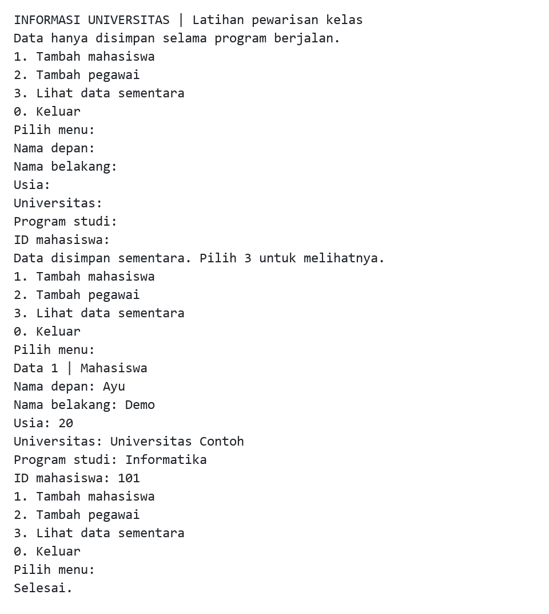

# University Information Java

Latihan terminal Java 17 untuk memasukkan dan menampilkan data mahasiswa serta pegawai. `Student` dan `Employee` mewarisi nama depan, nama belakang, dan usia dari `Person`. Data hanya berada di memori selama program berjalan.

## Contoh keluaran terminal



Transkrip hasil eksekusi program yang dirender menjadi gambar. Contoh memakai mahasiswa sintetis Ayu Demo, Universitas Contoh, program studi Informatika, dan ID `101`. Gambar memuat stdout program tanpa menampilkan ulang masukan stdin.

## Build dan jalankan

Siapkan JDK 17 dan Maven 3.9 atau lebih baru:

```sh
git clone https://github.com/zalamanga/university-information-java.git
cd university-information-java
mvn verify
java -jar target/university-information-java.jar
```

Perintah berlaku di PowerShell, Linux, dan macOS. Maven mengunduh plugin dan JUnit saat build pertama. JAR yang dihasilkan hanya memerlukan JDK; tidak ada database atau dependency runtime tambahan. Buka `pom.xml` jika memakai IDE Maven.

## Menu dan masukan

| Pilihan | Tindakan |
| --- | --- |
| `1` | Masukkan mahasiswa: nama depan/belakang, usia, universitas, program studi, dan ID mahasiswa. |
| `2` | Masukkan pegawai: nama depan/belakang, usia, departemen, jabatan, dan gaji. |
| `3` | Tampilkan seluruh data sementara melalui perilaku kelas turunannya. |
| `0` | Keluar; seluruh data sesi berakhir. |

Setiap field dibaca satu baris sehingga nama dan jabatan dapat mengandung spasi. Nama depan/belakang wajib diisi, maksimal 100 karakter; universitas, program studi, departemen, dan jabatan maksimal 150 karakter. Spasi awal/akhir dibuang dan karakter kontrol ditolak.

Input dan output memakai UTF-8. Pada terminal Windows lama, jalankan `chcp 65001` sebelum membuka JAR jika karakter non-ASCII tidak terbaca dengan benar.

Usia dibatasi `1` sampai `150` untuk latihan. ID mahasiswa merupakan bilangan bulat positif sampai `2147483647`, sesuai field integer asal. ID tidak dijamin unik; aplikasi ini belum menyediakan pencarian atau pengelolaan identitas kampus.

Gaji menerima angka nonnegatif, maksimal 18 digit bulat dan dua desimal dengan titik, misalnya `5000000.50`. Koma, notasi ilmiah, simbol mata uang, tanda `+`, dan nilai negatif ditolak. Gaji disimpan sebagai `BigDecimal` dan ditampilkan dengan dua desimal, tanpa perhitungan pajak atau payroll.

Input tidak valid meminta ulang field tersebut. Akhir masukan (EOF) menghentikan program; record yang belum lengkap tidak disimpan. Pilihan `3` pada sesi kosong menampilkan `Belum ada data.`.

## Pengujian dan struktur

`mvn verify` memeriksa pewarisan, field mahasiswa/pegawai, ketepatan gaji desimal, batas nilai, pengulangan input tidak valid, menu kosong, EOF tanpa record parsial, dan pemisahan data antar-sesi.

```text
src/main/java/university/
  Person.java, Student.java, Employee.java  Model dan tampilan polimorfik
  MainMenu.java                            Menu dan daftar sementara
  ConsoleInput.java                        Pembacaan serta validasi input
src/test/java/university/                   Tes model dan alur terminal
```

Versi awal memakai beberapa `Scanner` pada stream yang sama, menu satu kali, dan main class NetBeans yang tidak sesuai source. Versi Maven memakai satu pembaca input, menu berulang, dan entry point `university.MainMenu`.

## Batas dan asal sumber

Ini latihan pewarisan kelas, bukan sistem informasi kampus. Data tidak ditulis ke file, tidak bertahan setelah keluar, dan tidak memiliki fitur edit/hapus, autentikasi, atau integrasi layanan lain. Gunakan data contoh saat mencoba.

Lihat [NOTICE.md](NOTICE.md) untuk pemetaan kelas asal dan status atribusi/lisensi. Folder build `target/` tidak disertakan dalam Git.
