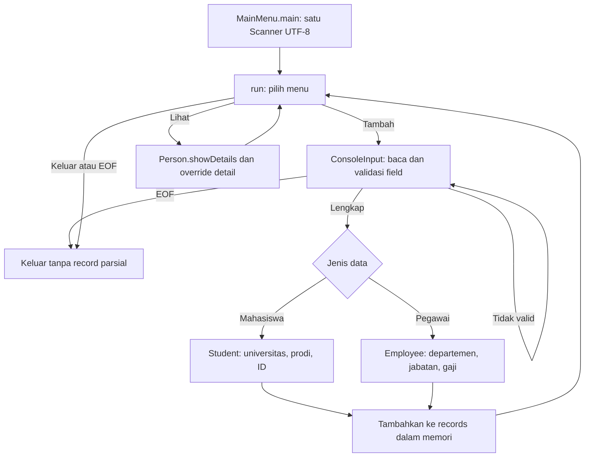

# Alur kode University Information

Menu mengumpulkan field lengkap sebelum membuat objek. `Student` dan `Employee` mewarisi identitas dari `Person`; daftar sesi menampung keduanya sebagai `List<Person>`.

Nama dan field teks menolak karakter kontrol. Usia dan ID memiliki batas integer. Gaji dibaca sebagai `BigDecimal`, bukan floating point. Data baru ditambahkan setelah semua field tersedia; EOF tidak menyimpan setengah formulir.

| Bagian | Sumber |
| --- | --- |
| Menu dan daftar sesi | [MainMenu.java](../src/main/java/university/MainMenu.java) |
| Pembacaan serta pengulangan input | [ConsoleInput.java](../src/main/java/university/ConsoleInput.java) |
| Identitas dan tampilan polimorfik | [Person.java](../src/main/java/university/Person.java), [Student.java](../src/main/java/university/Student.java), [Employee.java](../src/main/java/university/Employee.java) |
| Tes model dan alur terminal | [PersonTest.java](../src/test/java/university/PersonTest.java), [MainMenuTest.java](../src/test/java/university/MainMenuTest.java) |

Daftar hilang saat proses selesai. ID mahasiswa belum dijamin unik; aplikasi ini latihan pewarisan, bukan database kampus. Lihat [README](../README.md) untuk setup dan format input.
